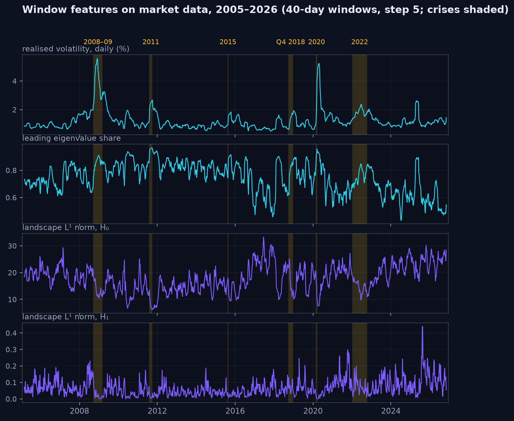

# TDA on financial time series — regime change detection

[](https://github.com/crozol/05-tda-finance/actions/workflows/tests.yml)
[](https://opensource.org/licenses/MIT)
[](https://crozol.github.io/projects/05-tda-finance.html)
[](https://doi.org/10.5281/zenodo.24095680)

**TL;DR** — Do topological features of sliding windows of daily returns
detect crisis regimes better than realised volatility and the eigenvalues of
the correlation matrix together, on leakage-free folds? The analysis plan,
with its success criterion, was fixed before any result (version 0.1.2,
[doi:10.5281/zenodo.24356109](https://doi.org/10.5281/zenodo.24356109)) and
run once on market data on 2026-11-19. **The criterion is not met:** the
combined model wins in 2 of the 5 counted crises under leave-one-crisis-out
(4 needed) and in 3 of the 4 that the walk-forward can score (3 needed);
with logistic regression, the plan's check, ΔAUC is negative in all five
under leave-one-crisis-out. **The result is inconclusive rather than
negative.** Every feature compared, the baselines included, ignores the sign
of the returns, while the label, being inside a peak-to-trough drawdown,
depends on it: inside the held-out blocks the baselines are near chance
(ROC-AUC 0.45–0.58 in four of the five crises), and in three of those four
the windows after the trough are as volatile as the crisis or more. Analyses
added after the result, declared in the code before they were computed, find
no evidence on market data (Holm-adjusted p ≥ 0.96), with power of 4 to 7 in
20 on synthetic crises far easier to see than the market's; every p-value at
or below 0.05 belongs to a statistic or comparison that the reading, fixed
before the market data, does not count. A negative control in the tests
shows that shuffled k-fold gives ROC-AUC ≈ 0.97 to an unrelated feature,
against ≈ 0.5 with purged folds.
Stack: giotto-tda · scikit-learn · pandas · NumPy · yfinance.

Using **persistent homology** on sliding windows of multi-asset returns to
detect market regime changes (the 2008 crisis, the 2020 crash, normal periods).

## Motivation

Classical methods for detecting regime changes in finance rely on variance,
rolling correlations and hidden Markov models. Topological Data Analysis
offers a complementary angle: treat each window of daily returns as a point
cloud in `ℝ^d` (one point per day, one axis per asset) and summarise its
*shape* with persistence diagrams, which are stable under small perturbations
of the data.

## Hypothesis

Gidea & Katz (2018) found that the `L^p` norms of persistence landscapes of
sliding windows of four US equity indices grow in the run-up to the 2000 and
2008 crashes. The question this project tests is narrower and harder: **do
topological features detect crisis regimes better than realised volatility
and the eigenvalues of the correlation matrix together, evaluated on the same
leakage-free folds?** A crisis raises volatility and makes assets move
together, and both effects also change a persistence diagram, so an
improvement over a model with no baselines would not show that topology adds
anything.

## Evaluation design

- **Labels fixed in advance.** Crisis periods are listed in `src/data.py`
  (`CRISIS_PERIODS`: 2008–09, 2011, 2015, Q4 2018, 2020, 2022) with the event that
  bounds each one, and are not tuned afterwards. A window is labelled by its
  *last* day, so a window counts as "crisis" only once the crisis has begun.
- **No leakage between overlapping windows.** With a 40-day window and a
  5-day step, neighbouring windows share 35 days, so shuffled k-fold puts
  near-copies of every test window in the training set (López de Prado, 2018).
  `src/validation.py` provides two schemes that avoid it:
  - **purged walk-forward**: train on the past, test on the next block, and
    drop the 7 windows in between, so no training window shares a day with a
    test window;
  - **leave one crisis out**: hold out each crisis with its surrounding
    normal windows, train on the rest minus a purge gap on both sides.
- **Baselines on identical folds.** Realised volatility and the eigenvalues
  of the correlation matrix, as shares of their sum (the first one is the
  one-component absorption ratio of Kritzman et al., 2011), are scored with
  the same model and splits as the topological features, alone and combined.
- **Scale removed from the topology.** Each window is standardised per asset
  before computing persistence, so the diagrams describe the shape of the
  joint distribution rather than re-measuring its volatility. Standardising
  removes the volatility level of a window, not a change of volatility inside
  it: a window that mixes calm and turbulent days is still a mixture of two
  scales, and the diagrams can see it (point 10).
- **Success criterion.** Defined in the analysis plan below, before any
  result.

`tests/test_validation.py` checks that the purged splits share no day between
training and test windows (and that one window less of purge would), that
every crisis is held out once, and demonstrates the leakage on synthetic
data: a feature with no relation to the label, but slowly varying in time,
reaches a ROC-AUC near 0.97 under shuffled k-fold and about 0.5 under purged
walk-forward.

## Analysis plan (fixed before any result)

Committed before any feature is computed on market data (`bb57e7e`,
2026-10-17) and amended three times, still before any result, on
2026-11-10, 2026-11-16 and 2026-11-19 (lists at the end of this section). Any
change made after the first result will be listed there too, with its date and
reason.

- **Data.** Daily adjusted closes of the seven tickers in `src/data.py`,
  2005-01-03 to 2026-11-06, downloaded with yfinance 1.8.0 on 2026-11-10 and
  frozen as `data/prices_2026-11-10.csv` (SHA-256
  `10535bf43cf79624dd9c81f2284d4520e49235981fa25061e9431c7aa1d6ae29`). Every
  result uses this file; Yahoo revises adjusted prices retroactively, so a new
  download need not match it.
- **Episodes.** Six crisis periods (`src/data.py`). A window is positive when
  its last day falls inside one; on the frozen data that gives 24 positive
  windows for 2008–09, 9 for 2011, 2 for 2015, 13 for Q4 2018, 5 for 2020 and
  39 for 2022 (1 092 windows in all). The 2015 episode is reported but not
  counted, so the effective number of episodes is 5. The 2020 AUC rests on
  5 positive windows and counts as much as the 2022 one, which rests on 39;
  every episode is reported with its number of positive windows. With so few
  episodes, the conclusion is qualitative; no p-value is computed across
  episodes.
- **Primary comparison.** Topological features plus realised volatility and
  the correlation spectrum, against volatility and the spectrum alone. Reported,
  not counted: three other controls for the topology (point 11) and the primary
  comparison with the settings of Gidea & Katz (point 13).
- **Splits.** Under leave-one-crisis-out, the test block of an episode is its
  positive windows plus 12 normal windows (60 trading days) on each side, the
  stretch over which the alarm is searched; the model is trained on every
  other window except the 7-window purge on each side. The walk-forward uses
  the same test blocks but trains only on the windows that end before the
  block, minus the purge, as a detector running in real time would. The
  2008–09 episode has no earlier crisis to learn from and cannot be scored
  this way, so the walk-forward scores four counted episodes: 2011, Q4 2018,
  2020 and 2022.
- **Seeds.** Every random forest is fitted with 10 seeds (0–9); every ROC-AUC
  and average precision is the mean over them. The alarm rule needs one score
  per window, so it uses the probability averaged over the 10 forests, which
  is itself a forest of 3 000 trees: one threshold and one alarm per score and
  episode.
- **Success criterion.** For each held-out episode, ΔAUC is the ROC-AUC of
  the combined model minus that of the baselines alone, averaged over the 10
  seeds. An episode counts as a win only if that mean exceeds the standard
  deviation of ΔAUC across the seeds. The combined model succeeds if it wins
  in at least 4 of the 5 counted episodes under leave-one-crisis-out and in
  at least 3 of the 4 that the walk-forward can score. If topology added
  nothing and each episode were a coin flip, 4 of 5 would still happen with
  probability 6/32 ≈ 0.19 and 3 of 4 with probability 5/16 ≈ 0.31, so the two
  together pass by chance with probability at most 0.19: the criterion is a
  filter, not evidence on its own. On synthetic data in which crises change
  only volatility and correlation it passed in 3 of 20 datasets, and in
  7 of 20 when crises change only the tails (points 10 and 12). Average
  precision is reported alongside.
- **"Detects earlier", defined.** For each episode and each score — the
  random-forest probability of the combined model, of the baselines alone and
  of volatility alone — with the same rule for all three:
  - threshold: the last 20 % of the windows of the training fold form a
    calibration block, separated from the rest by the same 7-window purge. The
    model is fitted on the rest, the threshold is the 95th percentile of its
    score on the normal windows of the calibration block, and that same model
    scores the held-out episode;
  - alarm: the first window, from 60 trading days before the start of the
    crisis, that completes a run of 3 consecutive windows above the
    threshold: the alarm is raised on the third window of the run, the first
    at which the run is known, with no look-ahead;
  - lead time: trading days from the alarm to the drawdown minimum (the end
    date of the episode). No alarm before the minimum counts as a miss.
- **Fixed parameters.** Window 40 days, step 5, homology dimensions 0 and 1.
  For each dimension, the `L¹` and `L²` norms of the persistence landscape
  summed over all its layers, `‖λ‖_p = (Σ_k ‖λ_k‖_p^p)^{1/p}`, as in Gidea &
  Katz (2018, eq. 2.3): four features. Gidea & Katz use dimension 1 only,
  windows of 50 and 100 days and a step of one day. The integrals are Riemann
  sums on giotto-tda's default grid, 100 points per dimension from the
  smallest birth to the largest death over all windows: the grid uses no
  label, but its range includes later windows. A random forest of 300 trees
  as the main model (logistic regression as a check). Realised volatility is
  the mean over the seven assets of the standard deviation of their daily log
  returns in the window; the spectrum, the seven eigenvalues of the window's
  correlation matrix in decreasing order, divided by seven; the kurtosis,
  Mardia's (1970) multivariate kurtosis of the window. These are the defaults
  in `src/` and are not tuned on the held-out episodes.

**Amendments before any result (2026-11-10).** An external review of the plan
found four problems, and one definition needed to be made precise; all are
fixed above, and none of them uses a feature or a score computed on market
data.

1. *Threshold.* The 95th percentile of the score on the normal windows of the
   training fold is degenerate for a random forest, which scores its own
   training windows near 0. Out-of-bag scores do not fix it: the bootstrap
   ignores time, so every out-of-bag window has in-bag neighbours that share
   35 of its 40 days, the leakage the negative control demonstrates. The
   threshold now comes from a purged calibration block inside the training
   fold, and the three scores are now of the same kind (model probabilities),
   with the combined model in place of topology alone, as in the primary
   comparison.
2. *Success criterion.* "Higher ROC-AUC in at least 4 of 5 episodes", by any
   margin, passes by chance with probability 0.19, and the random-forest seed
   alone can flip a small difference. Now: the mean over 10 seeds, a margin
   equal to the spread between seeds, and the 0.19 stated.
3. *Positive windows per episode,* added: the 2020 episode has 5.
4. *Frozen data* with its SHA-256, since yfinance is unofficial and adjusted
   prices change retroactively.
5. *Alarm time.* "The first window after which the score exceeds the threshold
   for 3 consecutive windows" could be read as the first window of the run,
   which is only known two windows later. The alarm is now the third window
   of the run.

**Second amendment before any result (2026-11-16).** Writing
`scripts/run_plan.py`, which runs the plan end to end, showed four points the
plan left open. They are fixed above. Only a synthetic dry run has been
executed; no feature or score has been computed on market data.

6. *Test blocks.* "The surrounding normal windows" of a held-out episode had
   no number: now 12 on each side (60 trading days), the stretch the alarm
   search covers.
7. *Walk-forward.* "By the same rule" cannot apply as written: trained only on
   the past, 2008–09 has no earlier crisis to learn from, which leaves four
   counted episodes. The walk-forward now uses the leave-one-crisis-out test
   blocks with past-only training and needs 3 of 4 (5/16 ≈ 0.31 by chance).
8. *One alarm per episode.* With 10 seeds the rule gave ten thresholds and ten
   alarms per score; it now uses the probability averaged over the seeds.
9. *Landscape norms.* The plan named the norms but not how they are computed.
   giotto-tda's default keeps only the first landscape layer, while the norm
   of Gidea & Katz (2018), whose finding the hypothesis tests, sums over all
   layers; the features now use their definition (`c730476`). The grid of the
   Riemann sums stays at giotto-tda's default and is stated above.

**Third amendment before any result (2026-11-19).** Before the plan was run on
market data, its criterion was run on synthetic data
(`scripts/calibrate_plan.py`, one file per dataset in `results/`): datasets
with the crisis periods of `src/data.py`, in which a crisis, and the 30 days
before it, doubles volatility and raises the correlation between assets from
0.3 to 0.7, with Gaussian days, so that topology has no shape of its own to
detect (the null); the same with heavy-tailed crisis days (multivariate
Student t, 3 degrees of freedom, same correlation); and a positive control in
which crises change only the tails. No market data were used. Each cell is the
number of 20 datasets in which the whole criterion passed:

| Comparison | Gaussian crises (null) | Heavy-tailed crises | Tails only (positive control) |
|---|---|---|---|
| topology + spectrum + volatility vs spectrum + volatility (primary) | 3/20 | 0/20 | 7/20 |
| topology + spectrum vs spectrum | 6/20 | 1/20 | 11/20 |
| primary, with Mardia's kurtosis on both sides | 1/20 | 1/20 | 2/20 |
| topology + leading eigenvalue vs eigenvalue (plan v0.1.1) | 8/20 | 5/20 | 20/20 |
| primary, Gidea & Katz settings: H1, 50-day windows | 0/20 | – | – |
| primary, Gidea & Katz settings: H1, 100-day windows | 0/20 | – | – |

10. *Primary comparison.* Topology plus the leading eigenvalue share against
    that share alone passed in 8 of the 20 null datasets (95 % interval
    19–64 %), above the 0.19 stated for chance. Two channels were left open.
    Correlation: for independent Gaussian days, the distances between the
    days of a standardised window, all that persistence uses, depend on the
    window's correlation matrix only through its eigenvalues
    (`src/features.py`), so the full spectrum is the complete correlation
    control; with it the rate fell only to 6 of 20.
    Volatility: standardising removes the volatility level of a window, not a
    change inside it, and near the start of a crisis the label is almost a
    function of the fraction of turbulent days in the window (ROC-AUC
    0.96–0.99 inside the held-out blocks of the counted episodes). The
    hypothesis names volatility as a baseline, but the primary comparison left
    it out. With volatility and the spectrum on both sides the criterion
    passed in 3 of the 20 null datasets (3–38 %), in line with the 0.19
    stated for chance.
11. *Reported comparisons.* Three other controls are reported with the primary
    comparison and count for nothing: the spectrum alone; the primary
    comparison with Mardia's multivariate kurtosis on both sides; and the
    leading eigenvalue share, the primary comparison of version 0.1.1. For
    independent elliptical days, the persistence of a standardised window
    depends on the correlation matrix only through its spectrum and otherwise
    on the law of the days' distances from the centre, whose leading summary
    is the kurtosis: a gain that survives it needs structure beyond the fourth
    moment. The hypothesis does not name the kurtosis, so it is not counted.
12. *Positive control.* With volatility and correlation unchanged and the
    crises only in the tails, a criterion with power should pass. Topology
    plus the leading eigenvalue share passed in 20 of 20 datasets, so the
    topological features see the tails. Realised volatility takes much of
    that signal, since a heavy-tailed window has an unusual standard
    deviation, and the kurtosis nearly all of it: the primary comparison
    passed in 7 of 20 (15–59 %), against 3 on the null, and with the
    kurtosis on both sides in 2. Its power is real but modest. When
    heavy-tailed crises also change volatility and correlation, the baselines
    alone separate them and it passed in 0 of 20.
13. *Settings of Gidea & Katz, reported.* The analysis is also run as Gidea &
    Katz (2018) set it up: homology in dimension 1 only, windows of 50 and 100
    days (`--setting gidea-katz-50` and `gidea-katz-100`). The step stays at
    5 days, and the purge grows with the window (9 and 19 windows). On the
    null data the primary comparison passed in none of the 20 datasets with
    either window, and topology plus the leading eigenvalue share in 0 and 2.
    These runs count for nothing.

**After the first result.** Nothing in this plan was changed after it was
run on market data (2026-11-19). Three additions, listed as promised above:

14. *Analyses added after the result* (`a69d18e`, 2026-11-19), declared
    before they were computed, and the reading of their rule (`7bb229f`,
    2026-11-20), fixed before any of them was computed on market data. They
    do not change the criterion or its verdict (section "Analyses added after
    the result").
15. *Correction to point 12* (2026-11-20). "Its power is real but modest"
    overstates it: 7 passes in 20 on crises only in the tails against 3 in
    20 on the null is no significant difference (Fisher's exact test,
    two-sided p = 0.27). The criterion had little power on its own positive
    control and almost none on heavy-tailed crises (0 of 20).
16. *Direction diagnostic* (`d76881d`, 2026-11-20), at the request of an
    external review of the result, declared in the code with that review's
    prediction before it was computed (results `4e083ed`). It does not
    change the criterion or its verdict (section "Why the market test says
    little").

## First result (2026-11-19)

Version 0.1.2 of the plan was run once on the frozen prices
(`python -m scripts.run_plan --data frozen`, commit `caf7aaa`;
`results/plan.json`). **The success criterion is not met:** the primary
comparison wins in 2 of the 5 counted episodes under leave-one-crisis-out
(4 needed) and in 3 of the 4 that the walk-forward can score (3 needed);
success needs both.

| Episode (positive windows) | ΔAUC, leave one crisis out | ΔAUC, walk-forward |
|---|---|---|
| 2008–09 (24) | +0.041 ± 0.055 | not scorable |
| 2011 (9) | **+0.078 ± 0.009** | +0.012 ± 0.013 |
| 2015 (2, not counted) | +0.017 ± 0.047 | −0.002 ± 0.090 |
| Q4 2018 (13) | −0.045 ± 0.022 | **+0.058 ± 0.042** |
| 2020 (5) | +0.029 ± 0.035 | **+0.042 ± 0.025** |
| 2022 (39) | **+0.043 ± 0.017** | **+0.042 ± 0.021** |
| Wins | 2 of 5 (4 needed) | 3 of 4 (3 needed) |

ΔAUC: mean ± standard deviation over the 10 random-forest seeds; bold, a win
(mean above the spread).

- Inside the held-out blocks, each crisis with the 60 trading days on either
  side, the classes barely separate: under leave-one-crisis-out the ROC-AUC
  of the combined model is 0.49–0.61 in every counted episode but 2011
  (0.99), below that of volatility alone (0.55–0.71) in those four.
- Reported, not counted (wins under leave-one-crisis-out / walk-forward):
  topology + spectrum against the spectrum, 2 / 3; the primary comparison
  with Mardia's kurtosis on both sides, 4 / 2; the comparison of version
  0.1.1, 3 / 3; logistic regression in place of the forest, 0 / 1; the
  settings of Gidea & Katz, 2 / 0 with 50-day windows and 1 / 2 with 100-day
  windows. None meets the criterion.
- The plan's check does not support the forest's wins. With logistic
  regression in place of the forest, ΔAUC is negative in all five counted
  episodes under leave-one-crisis-out (−0.003 to −0.062), and of the three
  wins under the walk-forward only 2020 keeps its sign (Q4 2018 −0.067,
  2022 −0.104).
- Alarms (the rule of the plan; trading days before the drawdown minimum):
  under leave-one-crisis-out, the combined model and the baselines alone
  warn only in 2022 (80), volatility alone in 2008–09 (106), 2011 (30) and
  2022 (75); under the walk-forward, the combined model in 2011 (25) and 2020
  (5), the baselines alone in 2011 (25), volatility alone in 2011 (20).



Realised volatility, the leading eigenvalue share and the landscape `L¹`
norms in dimensions 0 and 1 of every window, 2005–2026, crisis periods
shaded (`scripts/plot_features.py`; drawn after the result, descriptive).
The dimension-0 norm falls in most crises, mirroring the rise of the leading
eigenvalue share, as the dependence of persistence on the correlation
spectrum predicts.

## Analyses added after the result

The criterion has almost no power where it matters: on heavy-tailed
synthetic crises, which change volatility, correlation and the tails at
once, it passed in 0 of 20 datasets (point 12). An external review of
version 0.1.2, written before it saw the result, traced this to the ceiling
of the ROC-AUC and proposed tests that measure what the market data can and
cannot say. They were written in `scripts/post_result.py` and pushed
(`a69d18e`, 2026-11-19) before any of them was computed, on synthetic or
market data. They do not change the verdict above.

- **Statistics,** for the primary comparison and the same with Mardia's
  kurtosis on both sides, under both schemes, averaged over the counted
  episodes: ΔAUC (dAUC); the decrease in log-loss (dLL) and in Brier score
  (dBrier), proper scoring rules that still move near perfect separation;
  and ΔAUC on the pairs of a crisis and a normal window whose realised
  volatilities differ by at most 0.1 in log (dAUC|vol), where volatility
  cannot separate the classes.
- **Test.** Monte Carlo (Barnard, 1963): p = (1 + #{S_null ≥ S}) / (N + 1),
  against N = 99 synthetic null datasets (20 in each setting of Gidea &
  Katz). Leaving each null dataset out in turn, the size is 0.04 (0.05 with
  20).
- **Power,** the share of 20 synthetic datasets with p ≤ 0.05: on
  heavy-tailed crises (the realistic alternative), on crises only in the
  tails, and, in the plan's setting, on crises with lower-tail dependence
  through a Clayton copula, which neither the spectrum nor the kurtosis
  describes.
- **Reading** (`7bb229f`, 2026-11-20), fixed after the synthetic runs and
  before any statistic was computed on market data, since the rule written
  with the analyses named no threshold: a statistic has power when its power
  on heavy-tailed crises exceeds 0.05 by an exact one-sided binomial test at
  level 0.05 (at least 4 of 20). The market data are read on the primary
  comparison in the plan's setting, on the statistics with power, with
  Holm's (1979) correction across them; every other p-value is reported and
  counts for nothing.

Primary comparison, plan's setting. Power: datasets with p ≤ 0.05, with an
exact 95 % interval on heavy-tailed crises. In bold, the four statistics with
power, the only ones the reading counts.

| Scheme | Statistic | Heavy-tailed | Tails only | Clayton | Market S | p | Holm |
|---|---|---|---|---|---|---|---|
| leave one crisis out | dAUC | 3/20 (0.03–0.38) | 10/20 | 2/20 | +0.029 | 0.02 | – |
| | **dLL** | **5/20 (0.09–0.49)** | 12/20 | 4/20 | +0.024 | 0.35 | **1.00** |
| | **dBrier** | **5/20 (0.09–0.49)** | 13/20 | 3/20 | −0.003 | 0.96 | **1.00** |
| | dAUC\|vol | 3/20 (0.03–0.38) | 2/20 | 1/20 | −0.051 | 0.81 | – |
| walk-forward | dAUC | 1/20 (0.00–0.25) | 11/20 | 3/20 | +0.038 | 0.01 | – |
| | **dLL** | **7/20 (0.15–0.59)** | 9/20 | 3/20 | +0.041 | 0.24 | **0.96** |
| | dBrier | 2/20 (0.01–0.32) | 12/20 | 4/20 | +0.003 | 0.62 | – |
| | **dAUC\|vol** | **4/20 (0.06–0.44)** | 3/20 | 2/20 | +0.008 | 0.48 | **1.00** |

**Conclusion.** On the statistics that count, the market data give no
evidence that topology adds to realised volatility and the correlation
spectrum (Holm-adjusted p ≥ 0.96). Their power on realistic synthetic crises
is 4 to 7 in 20, so the absence of evidence says little, and less on market
data, where the baselines are near chance (section "Why the market test says
little"). Applied to each
synthetic dataset, the reading as a whole finds evidence in 7 of 20
heavy-tailed datasets (0.15–0.59), 11 of 20 with crises only in the tails,
3 of 20 Clayton and 4 of 99 null ones (computed on 2026-11-20, after the
market data, on synthetic data only).

- Every p-value at or below 0.05 is outside the family and counts for
  nothing: dAUC of the primary comparison (0.02 and 0.01), whose power on
  heavy-tailed crises was 3 and 1 in 20; the comparison with the kurtosis
  (dAUC, dLL and dBrier, 0.01–0.04, under leave-one-crisis-out; dAUC and
  dLL, 0.02, under the walk-forward); and 4 of the 32 statistics with the
  settings of Gidea & Katz, at 0.048 = 1/21, the smallest p-value 20 null
  datasets can give.
- The null is synthetic, and it differs from the market in more than
  topology. In the synthetic data, the fraction of a window's days in the
  crisis regime separates the label with ROC-AUC 0.96–0.99 inside the
  held-out blocks of the counted episodes (point 10); on market data, under
  leave-one-crisis-out, the combined model reaches 0.49–0.61 (2011 aside). A
  small p-value says that the market statistic is unusual for those
  datasets, not why: the dAUC of the comparison with the kurtosis under
  leave-one-crisis-out (+0.069) lies above every synthetic dataset of every
  scenario in the plan's setting.

<details>
<summary>All tables: both comparisons, both schemes, the three settings (<code>python -m scripts.post_result --tables</code>)</summary>

**plan** (99 null datasets)

| Scheme | Comparison | Statistic | Size | Heavy-tailed | Tails only | Clayton | Market S | p |
|---|---|---|---|---|---|---|---|---|
| leave one crisis out | primary | dAUC | 0.04 | 3/20 (0.03–0.38) | 10/20 (0.27–0.73) | 2/20 (0.01–0.32) | +0.0292 | 0.020 |
| leave one crisis out | primary | dLL | 0.04 | 5/20 (0.09–0.49) | 12/20 (0.36–0.81) | 4/20 (0.06–0.44) | +0.0242 | 0.350 |
| leave one crisis out | primary | dBrier | 0.04 | 5/20 (0.09–0.49) | 13/20 (0.41–0.85) | 3/20 (0.03–0.38) | −0.0027 | 0.960 |
| leave one crisis out | primary | dAUC\|vol | 0.04 | 3/20 (0.03–0.38) | 2/20 (0.01–0.32) | 1/20 (0.00–0.25) | −0.0506 | 0.810 |
| leave one crisis out | kurtosis | dAUC | 0.04 | 5/20 (0.09–0.49) | 5/20 (0.09–0.49) | 0/20 (0.00–0.17) | +0.0690 | 0.010 |
| leave one crisis out | kurtosis | dLL | 0.04 | 7/20 (0.15–0.59) | 2/20 (0.01–0.32) | 5/20 (0.09–0.49) | +0.0878 | 0.010 |
| leave one crisis out | kurtosis | dBrier | 0.04 | 9/20 (0.23–0.68) | 3/20 (0.03–0.38) | 3/20 (0.03–0.38) | +0.0123 | 0.040 |
| leave one crisis out | kurtosis | dAUC\|vol | 0.04 | 4/20 (0.06–0.44) | 0/20 (0.00–0.17) | 2/20 (0.01–0.32) | −0.0147 | 0.570 |
| walk-forward | primary | dAUC | 0.04 | 1/20 (0.00–0.25) | 11/20 (0.32–0.77) | 3/20 (0.03–0.38) | +0.0384 | 0.010 |
| walk-forward | primary | dLL | 0.04 | 7/20 (0.15–0.59) | 9/20 (0.23–0.68) | 3/20 (0.03–0.38) | +0.0411 | 0.240 |
| walk-forward | primary | dBrier | 0.04 | 2/20 (0.01–0.32) | 12/20 (0.36–0.81) | 4/20 (0.06–0.44) | +0.0029 | 0.620 |
| walk-forward | primary | dAUC\|vol | 0.04 | 4/20 (0.06–0.44) | 3/20 (0.03–0.38) | 2/20 (0.01–0.32) | +0.0076 | 0.480 |
| walk-forward | kurtosis | dAUC | 0.04 | 1/20 (0.00–0.25) | 5/20 (0.09–0.49) | 1/20 (0.00–0.25) | +0.0288 | 0.020 |
| walk-forward | kurtosis | dLL | 0.04 | 12/20 (0.36–0.81) | 2/20 (0.01–0.32) | 6/20 (0.12–0.54) | +0.0642 | 0.020 |
| walk-forward | kurtosis | dBrier | 0.04 | 4/20 (0.06–0.44) | 1/20 (0.00–0.25) | 4/20 (0.06–0.44) | +0.0088 | 0.090 |
| walk-forward | kurtosis | dAUC\|vol | 0.04 | 3/20 (0.03–0.38) | 0/20 (0.00–0.17) | 1/20 (0.00–0.25) | −0.0096 | 0.530 |

**gidea-katz-50** (20 null datasets)

| Scheme | Comparison | Statistic | Size | Heavy-tailed | Tails only | Clayton | Market S | p |
|---|---|---|---|---|---|---|---|---|
| leave one crisis out | primary | dAUC | 0.05 | 1/20 (0.00–0.25) | 10/20 (0.27–0.73) | – | +0.0254 | 0.048 |
| leave one crisis out | primary | dLL | 0.05 | 10/20 (0.27–0.73) | 13/20 (0.41–0.85) | – | −0.0172 | 0.952 |
| leave one crisis out | primary | dBrier | 0.05 | 4/20 (0.06–0.44) | 11/20 (0.32–0.77) | – | −0.0008 | 0.857 |
| leave one crisis out | primary | dAUC\|vol | 0.05 | 3/20 (0.03–0.38) | 4/20 (0.06–0.44) | – | +0.0493 | 0.143 |
| leave one crisis out | kurtosis | dAUC | 0.05 | 6/20 (0.12–0.54) | 6/20 (0.12–0.54) | – | +0.0067 | 0.095 |
| leave one crisis out | kurtosis | dLL | 0.05 | 10/20 (0.27–0.73) | 5/20 (0.09–0.49) | – | +0.0157 | 0.048 |
| leave one crisis out | kurtosis | dBrier | 0.05 | 8/20 (0.19–0.64) | 5/20 (0.09–0.49) | – | +0.0044 | 0.048 |
| leave one crisis out | kurtosis | dAUC\|vol | 0.05 | 4/20 (0.06–0.44) | 1/20 (0.00–0.25) | – | +0.0393 | 0.095 |
| walk-forward | primary | dAUC | 0.05 | 1/20 (0.00–0.25) | 9/20 (0.23–0.68) | – | −0.0079 | 0.810 |
| walk-forward | primary | dLL | 0.05 | 8/20 (0.19–0.64) | 11/20 (0.32–0.77) | – | −0.0014 | 0.667 |
| walk-forward | primary | dBrier | 0.05 | 7/20 (0.15–0.59) | 15/20 (0.51–0.91) | – | +0.0001 | 0.667 |
| walk-forward | primary | dAUC\|vol | 0.05 | 0/20 (0.00–0.17) | 1/20 (0.00–0.25) | – | −0.0172 | 0.714 |
| walk-forward | kurtosis | dAUC | 0.05 | 1/20 (0.00–0.25) | 4/20 (0.06–0.44) | – | −0.0016 | 0.667 |
| walk-forward | kurtosis | dLL | 0.05 | 6/20 (0.12–0.54) | 3/20 (0.03–0.38) | – | +0.0060 | 0.333 |
| walk-forward | kurtosis | dBrier | 0.05 | 6/20 (0.12–0.54) | 5/20 (0.09–0.49) | – | +0.0006 | 0.238 |
| walk-forward | kurtosis | dAUC\|vol | 0.05 | 1/20 (0.00–0.25) | 1/20 (0.00–0.25) | – | −0.0083 | 0.667 |

**gidea-katz-100** (20 null datasets)

| Scheme | Comparison | Statistic | Size | Heavy-tailed | Tails only | Clayton | Market S | p |
|---|---|---|---|---|---|---|---|---|
| leave one crisis out | primary | dAUC | 0.05 | 0/20 (0.00–0.17) | 3/20 (0.03–0.38) | – | −0.0370 | 0.762 |
| leave one crisis out | primary | dLL | 0.05 | 1/20 (0.00–0.25) | 3/20 (0.03–0.38) | – | −0.0577 | 0.952 |
| leave one crisis out | primary | dBrier | 0.05 | 0/20 (0.00–0.17) | 1/20 (0.00–0.25) | – | +0.0014 | 0.476 |
| leave one crisis out | primary | dAUC\|vol | 0.05 | 0/20 (0.00–0.17) | 0/20 (0.00–0.17) | – | −0.1275 | 1.000 |
| leave one crisis out | kurtosis | dAUC | 0.05 | 3/20 (0.03–0.38) | 1/20 (0.00–0.25) | – | −0.0611 | 0.952 |
| leave one crisis out | kurtosis | dLL | 0.05 | 9/20 (0.23–0.68) | 1/20 (0.00–0.25) | – | −0.0265 | 0.762 |
| leave one crisis out | kurtosis | dBrier | 0.05 | 6/20 (0.12–0.54) | 3/20 (0.03–0.38) | – | +0.0001 | 0.619 |
| leave one crisis out | kurtosis | dAUC\|vol | 0.05 | 1/20 (0.00–0.25) | 1/20 (0.00–0.25) | – | −0.0005 | 0.333 |
| walk-forward | primary | dAUC | 0.05 | 0/20 (0.00–0.17) | 5/20 (0.09–0.49) | – | +0.0727 | 0.048 |
| walk-forward | primary | dLL | 0.05 | 0/20 (0.00–0.17) | 10/20 (0.27–0.73) | – | +0.0306 | 0.286 |
| walk-forward | primary | dBrier | 0.05 | 0/20 (0.00–0.17) | 0/20 (0.00–0.17) | – | +0.0097 | 0.381 |
| walk-forward | primary | dAUC\|vol | 0.05 | 0/20 (0.00–0.17) | 2/20 (0.01–0.32) | – | −0.0539 | 0.667 |
| walk-forward | kurtosis | dAUC | 0.05 | 0/20 (0.00–0.17) | 0/20 (0.00–0.17) | – | +0.0459 | 0.095 |
| walk-forward | kurtosis | dLL | 0.05 | 3/20 (0.03–0.38) | 1/20 (0.00–0.25) | – | +0.0252 | 0.429 |
| walk-forward | kurtosis | dBrier | 0.05 | 0/20 (0.00–0.17) | 1/20 (0.00–0.25) | – | +0.0072 | 0.429 |
| walk-forward | kurtosis | dAUC\|vol | 0.05 | 0/20 (0.00–0.17) | 0/20 (0.00–0.17) | – | +0.0195 | 0.286 |

</details>

Summary: `results/post_result.json`; one file per dataset in
`results/post_result/`.

## Why the market test says little

Added after the result at the request of an external review of it
(2026-11-20), and declared in `scripts/direction_diagnostic.py`, with the
review's prediction, before any of it was computed (`d76881d`; results
`4e083ed`, `results/direction_diagnostic.json`). It does not change the
verdict, and none of it counts.

Every feature of the comparison, the baselines included, is unchanged when
every return changes sign and when the days of a window are reordered
(`tests/test_direction_diagnostic.py`): Vietoris-Rips persistence of a
standardised window uses only the distances between its days, and
volatility, the correlation spectrum and Mardia's kurtosis do not depend on
the sign of the returns. The label does: a window is a crisis window when its
last day falls inside a peak-to-trough drawdown. Inside a held-out block, the
crisis with the 12 windows (60 trading days) on either side, the windows that
end just after the trough still contain the last weeks of the drawdown, and
the rebound that follows can be as volatile.

ROC-AUC of the crisis windows of each block against its normal windows
before and after the crisis, under leave-one-crisis-out; forests, mean over
10 seeds:

| Crisis | Volatility, before | Volatility, after | Forest on volatility, before | Forest on volatility, after | Baselines | Baselines + mean return |
|---|---|---|---|---|---|---|
| 2008–09 | 1.00 | 0.75 | 0.71 | 0.39 | 0.45 | 0.61 |
| 2011 | 1.00 | 0.89 | 1.00 | 0.50 | 0.91 | 0.96 |
| Q4 2018 | 0.78 | 0.29 | 0.80 | 0.42 | 0.58 | 0.65 |
| 2020 | 1.00 | 0.25 | 0.91 | 0.43 | 0.58 | 0.69 |
| 2022 | 1.00 | 0.42 | 0.70 | 0.72 | 0.49 | 0.62 |

- Volatility separates every crisis from the windows before it (1.00 in
  four, 0.78 in Q4 2018). Against the windows after it, it falls to
  0.25–0.42 in Q4 2018, 2020 and 2022, where those windows are as volatile
  as the crisis or more, but not in 2008–09 (0.75) or 2011 (0.89).
- The forest on volatility alone ranks the 2008–09 and 2011 blocks worse
  than volatility itself (0.55 against 0.88, 0.75 against 0.94): there its
  weakness comes from what it learned on the other crises, not from the
  block.
- The review predicted an AUC of at least 0.8 against the windows before
  and at most 0.5 against those after in each of 2008–09, Q4 2018 and 2020.
  That holds for neither score: it fails in 2008–09 for both (the forest
  0.71 before; volatility 0.75 after, as `results/plan.json` implied before
  the run) and in Q4 2018 for volatility (0.78 before). The mechanism it
  proposed accounts for three of the five crises.
- The mean return of the window, which changes sign with the returns,
  raises the AUC of the baselines in every crisis under leave-one-crisis-out
  (by 0.05 to 0.16) and in three of the four the walk-forward can score, but
  outside 2011 it leaves them at 0.61–0.69 under leave-one-crisis-out.
- With the mean return on both sides, the primary comparison wins in 3 of 5
  crises under leave-one-crisis-out and in 2 of 4 under the walk-forward.

On market data, then, ΔAUC is measured around baselines near chance, and
the power of the analyses added after the result was measured on synthetic
crises far easier to see (section above): the market data could say little
about whether topology adds to the baselines.

## Stack

- Python 3.11+
- giotto-tda (persistent homology, landscapes)
- pandas, NumPy
- yfinance (market data)
- scikit-learn (classifiers, metrics)
- Matplotlib

## Structure

```
05-tda-finance/
├── README.md
├── LICENSE
├── CITATION.cff
├── requirements.txt      # the pinned environment of the analysis plan
├── src/
│   ├── data.py           # prices, log returns, crisis periods and labels
│   ├── persistence.py    # sliding windows, standardisation, Vietoris-Rips persistence
│   ├── features.py       # landscapes, landscape norms, volatility and eigenvalue baselines
│   ├── validation.py     # purged walk-forward, leave-one-crisis-out, fold scoring, alarm rule
│   └── classify.py       # models, seed average and feature-set comparison on shared folds
├── scripts/
│   ├── run_plan.py       # the analysis plan end to end: synthetic dry run by default, --data frozen
│   ├── calibrate_plan.py # how often the criterion passes on synthetic data
│   ├── post_result.py    # analyses added after the first run on market data
│   ├── direction_diagnostic.py  # why the market test says little: AUC against the windows before and after each crisis
│   └── plot_features.py  # the window features over time, crisis periods shaded
├── figures/              # features_timeseries.png
├── results/              # the run on market data (plan*.json), the analyses added after it (post_result*, direction_diagnostic.json), calibration summaries, one file per synthetic dataset
└── tests/
    ├── test_validation.py
    ├── test_features.py
    ├── test_plan.py
    ├── test_post_result.py
    └── test_direction_diagnostic.py
```

## Roadmap

- [x] Crisis labels fixed in advance; windows labelled by their last day.
- [x] Leakage-free validation: purged walk-forward and leave-one-crisis-out, with tests.
- [x] Baselines: realised volatility and the eigenvalue spectrum of the correlation matrix.
- [x] Success criterion run on synthetic data before any market data: null, heavy tails, positive control.
- [x] Daily prices of sector ETFs and indices, frozen with their SHA-256 (analysis plan); log returns.
- [x] Persistent homology (dimensions 0 and 1) on standardised windows.
- [x] Landscape norms as features.
- [x] Compare feature sets on both split schemes.
- [x] Time series of the features annotated with the crisis periods.
- [x] Plan run once on market data; analyses added after the result, declared before they were computed.
- [x] Diagnostic of the market test, added after the result and declared with the reviewer's prediction before it was computed.
- [ ] A new question, pre-registered as this one: early warning, windows that end before the peak of a drawdown against windows far from any (suggested by an external review).

## References

- Gidea, M. & Katz, Y. (2018). *Topological data analysis of financial time
  series: Landscapes of crashes.* Physica A 491, 820–834.
- Bubenik, P. (2015). *Statistical topological data analysis using
  persistence landscapes.* Journal of Machine Learning Research 16, 77–102.
- López de Prado, M. (2018). *Advances in Financial Machine Learning*, ch. 7
  (cross-validation in finance: purging and embargo). Wiley.
- Mardia, K. V. (1970). *Measures of multivariate skewness and kurtosis with
  applications.* Biometrika 57(3), 519–530.
- Kritzman, M., Li, Y., Page, S. & Rigobon, R. (2011). *Principal components
  as a measure of systemic risk.* Journal of Portfolio Management 37(4), 112–126.
- Tauzin, G. et al. (2021). *giotto-tda: A topological data analysis toolkit
  for machine learning and data exploration.* Journal of Machine Learning
  Research 22(39), 1–6.
- Barnard, G. A. (1963). Discussion of *The spectral analysis of point
  processes* by M. S. Bartlett. Journal of the Royal Statistical Society B
  25(2), 294.
- Holm, S. (1979). *A simple sequentially rejective multiple test procedure.*
  Scandinavian Journal of Statistics 6(2), 65–70.
