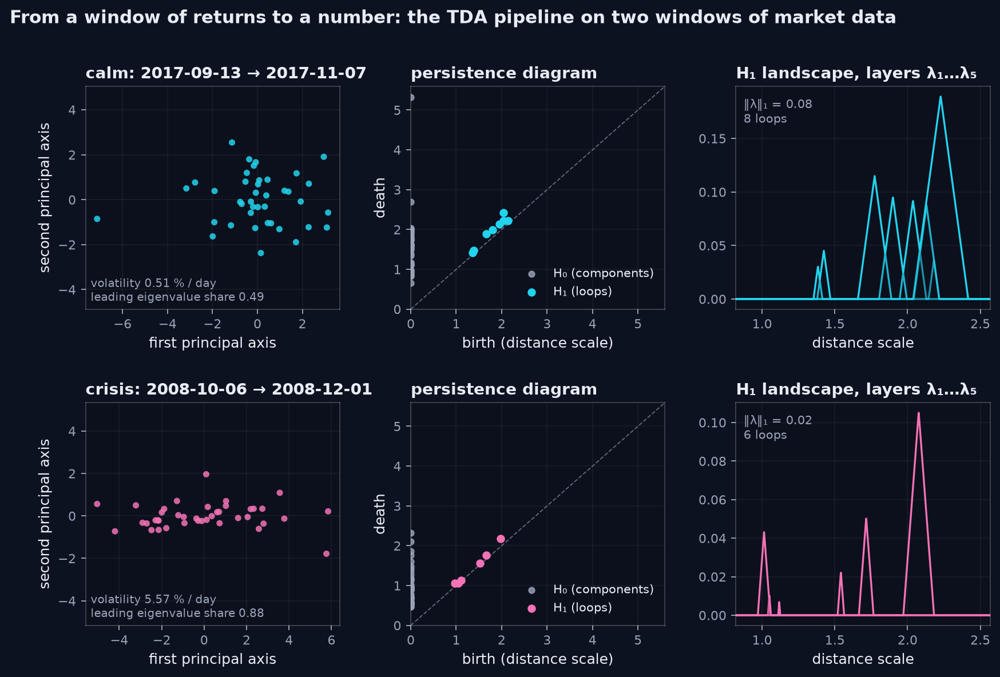
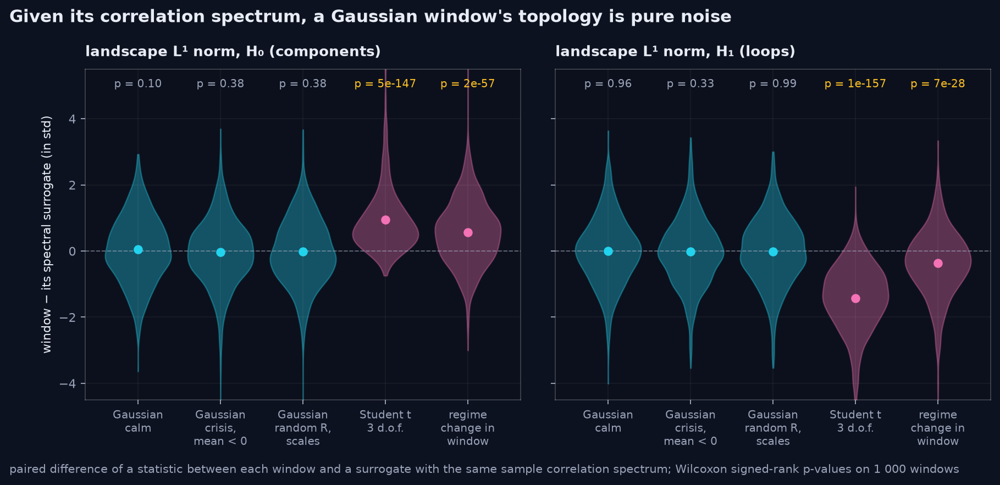
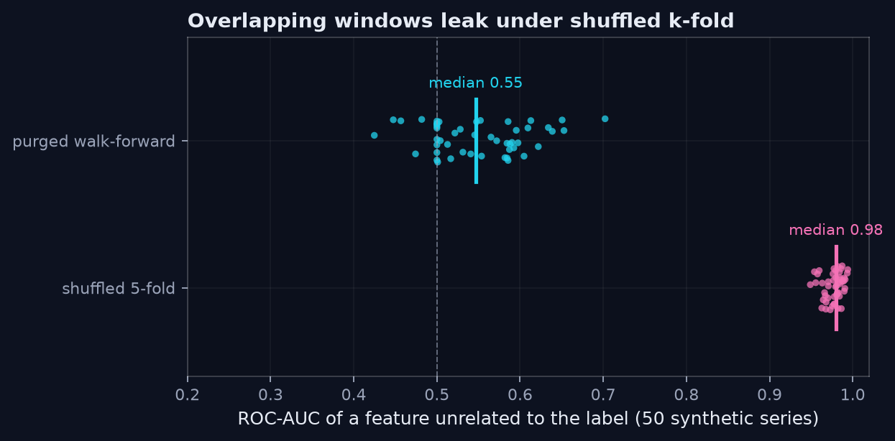
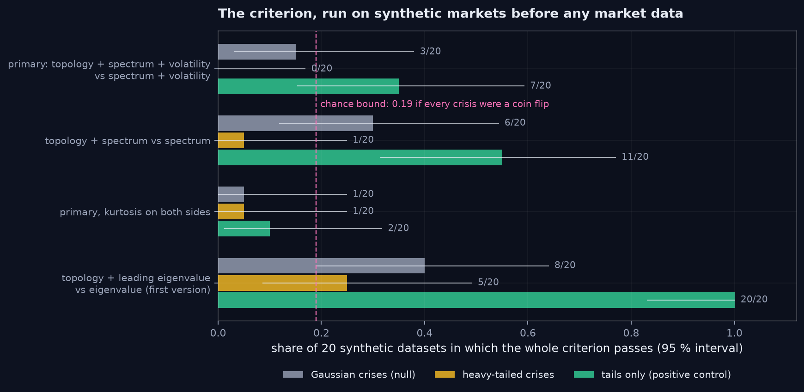
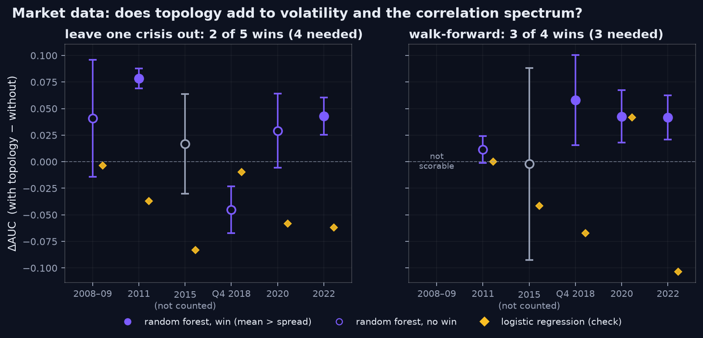
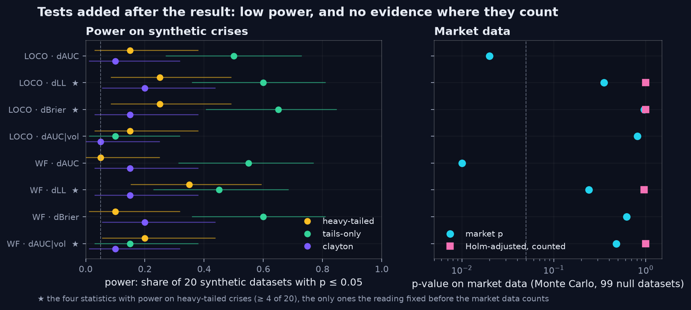
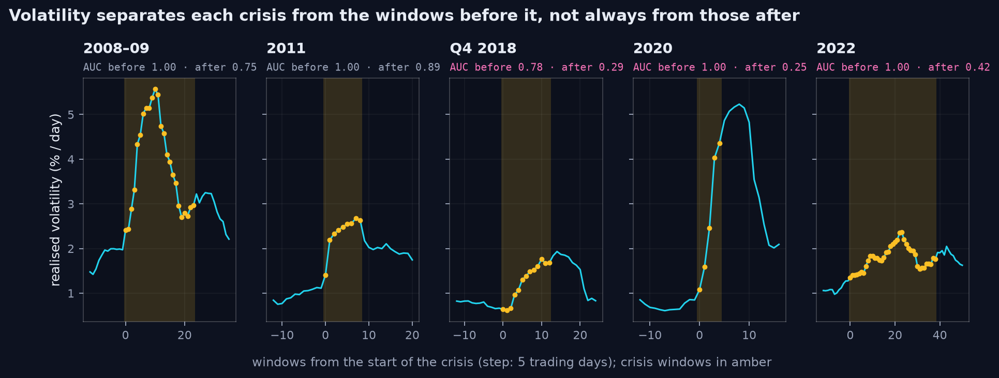
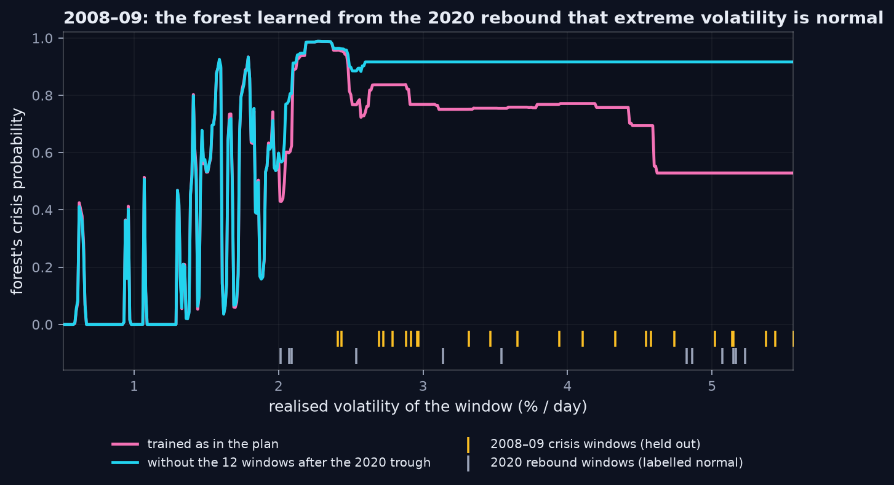
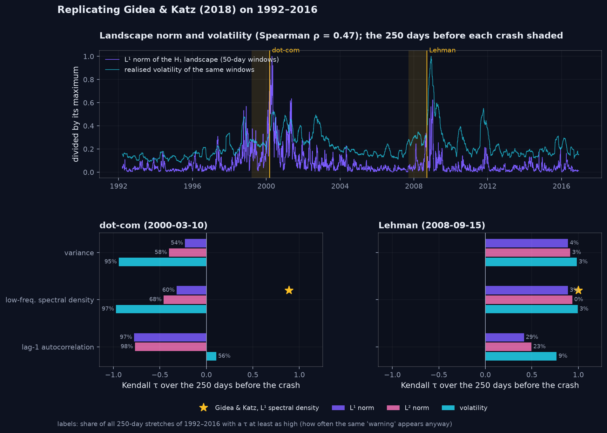

# TDA on financial time series — regime change detection

[](https://github.com/crozol/05-tda-finance/actions/workflows/tests.yml)
[](https://opensource.org/licenses/MIT)
[](https://crozol.github.io/projects/05-tda-finance.html)
[](https://doi.org/10.5281/zenodo.24095680)

Persistent homology of sliding windows of daily returns, scored against volatility and correlation
on leakage-free folds, with every test fixed before the market data were used.

**Summary**

- **Question.** Does the *shape* of a window of returns, measured with persistent homology, tell
  market regimes apart better than volatility and correlation, which a crisis also changes?
- **Theory.** For Gaussian days, the topology of a standardised window depends on everything else
  only through its sample correlation spectrum (Proposition 1, exact). Topology can add information
  only through heavy tails or a regime change inside the window; spectral surrogates confirm both
  sides (Section 3).
- **Study 1 — crisis detection,** pre-registered. The success criterion is not met: adding topology
  helps in 2 of 5 held-out crises (4 needed). The test could say little: the features ignore the sign
  of the returns, the drawdown label does not, and inside the held-out crises even the baselines
  are near chance (Section 4).
- **Replication of Gidea & Katz (2018).** The rise in the low-frequency power of the landscape norms
  before Lehman replicates (Kendall τ = 0.89; theirs 1.00), but realised volatility rises as much
  (τ = 0.99); before the dot-com peak neither rises (Section 5).
- **Study 2 — early warning,** pre-registered on 2026-11-24: *running* (Section 6).



*Figure 1. A calm window (2017) and a crisis window (October–December 2008) of seven ETFs. Left: the
40 standardised days on their first two principal axes; the crisis cloud is stretched along the
market mode. Middle: the persistence diagram. Right: the landscape of the loops (H₁).*

## Contents

1. [Background](#1--background)
2. [Data and pipeline](#2--data-and-pipeline)
3. [What topology can see](#3--what-topology-can-see)
4. [Study 1 — crisis detection](#4--study-1--crisis-detection)
5. [Replication of Gidea & Katz (2018)](#5--replication-of-gidea--katz-2018)
6. [Study 2 — early warning](#6--study-2--early-warning)
7. [Limitations](#7--limitations)
8. [Reproducing](#8--reproducing)
9. [Structure](#9--structure)
10. [References](#10--references)

## 1 · Background

- **Persistent homology** follows the connected components (H₀) and loops (H₁) of a point cloud as
  a distance scale grows; each feature becomes a point (birth, death) of a persistence diagram
  (Carlsson, 2009; Edelsbrunner & Harer, 2010). Diagrams are stable under small perturbations of the
  data (Cohen-Steiner, Edelsbrunner & Harer, 2007), and persistence landscapes turn them into
  functions with norms and means (Bubenik, 2015).
- **In finance,** a window of daily returns of d assets is a cloud of points in ℝᵈ, one per day.
  Gidea & Katz (2018) found that the norms of the landscapes of four US indices, and the variance and
  low-frequency power of those norms, rise in the months before the 2000 and 2008 crashes; Gidea
  (2017) reported similar signals in correlation networks.
- **What a crisis changes without topology.** Volatility rises; correlations rise in bear markets
  (Longin & Solnik, 2001); the share of variance in the first principal component, the absorption
  ratio, rises before drawdowns (Kritzman et al., 2011); and the variance of index returns rises
  before crashes, without the critical slowing down that precedes a bifurcation (Guttal et al., 2016).
- **The open question** is whether topology adds anything to these measures. It needs the baselines
  scored on the same folds, validation that does not leak between overlapping windows (López de
  Prado, 2018), and tests fixed before the data are seen (Nosek et al., 2018).

## 2 · Data and pipeline

| | Study 1 — crisis detection | Study 2 — early warning |
|---|---|---|
| Assets | 7 ETFs: SPY, QQQ, XLF, XLE, XLK, XLY, XLV | S&P 500, Dow Jones, Nasdaq, Russell 2000 |
| Period | 2005-01-03 → 2026-11-06 | 1992-01-02 → 2026-11-23 |
| Windows | 40 days, step 5 (1 092 windows) | 50 days, step 5 (1 748 windows) |
| Episodes | 6 crisis periods fixed in advance | 9 drawdowns by a rule on the S&P 500 (fall ≥ 15 %) |
| Label | the window ends inside a crisis | the window ends 1–60 trading days before a peak |
| Topology | standardised windows, H₀ and H₁ | raw returns, H₁, as Gidea & Katz |
| Baselines | volatility, correlation spectrum | volatility, correlation and covariance spectra |

Prices come from Yahoo Finance (yfinance) and are frozen with their SHA-256 (`src/data.py`,
`src/early_warning.py`). For each window:

1. log returns r_t = log(p_t / p_{t−1}) ∈ ℝᵈ, one point per day;
2. Vietoris–Rips persistence in dimensions 0 and 1 (giotto-tda; Tauzin et al., 2021);
3. the L¹ and L² norms of the persistence landscape, summed over all layers (Gidea & Katz, eq. 2.3);
4. the baselines of the same window: realised volatility, the eigenvalues of the correlation matrix
   and, for raw windows, of the covariance matrix.

## 3 · What topology can see

**Lemma (landscape norms in closed form).** Summed over all layers, the norm of a persistence
landscape is a total persistence (Cohen-Steiner et al., 2010):

```math
\|\lambda\|_p^p=\sum_k\int\lambda_k(x)^p\,dx=\sum_{(b,d)}\frac{(d-b)^{p+1}}{2^p\,(p+1)},
```

since at each x the layers are the tent values of the diagram's points in decreasing order. No grid
is needed (`src.features.total_persistence_norms`).

**Proposition 1.** Let the n days of a window be independent draws from N(μ, Σ) in ℝᵈ, n > d, and
let Z be the window standardised per asset with its own sample mean and standard deviation. Then

```math
ZZ^\top=n\,V\,\mathrm{diag}(\hat\lambda)\,V^\top,
```

where λ̂ are the eigenvalues of the window's sample correlation matrix and V, an n × d matrix with
orthonormal columns orthogonal to the vector of ones, is uniformly distributed and independent of λ̂.

*Proof.* The centred window A = (I − 11ᵀ/n)X has a law invariant under the rotations of ℝⁿ that fix
the vector of ones; they leave AᵀA unchanged, so the polar factor A(AᵀA)^(−1/2) is uniform given
AᵀA. The scales D of the standardisation are a function of AᵀA, and ZZᵀ = AD⁻¹Aᵀ has the
eigenvalues of D^(−1/2)AᵀAD^(−1/2) = nR̂, with eigenvectors fixed by AᵀA; the uniform frame times
them stays uniform. ∎

**Consequences.**

- A Vietoris–Rips diagram depends only on the distances between days, a function of ZZᵀ. Given the
  sample correlation spectrum, its law does not depend on μ or Σ.
- So if the days of each window are Gaussian, a regime that changes mean, volatility or correlation
  reaches the topology only through the spectrum, and the spectrum is the complete baseline.
- Topology can add something only through what the proposition rules out: heavy tails, or days of
  one window that do not share a law (a regime change inside the window).
- For raw, unstandardised windows the same argument gives the covariance spectrum (Study 2).

**Check** (`scripts/spectrum_check.py`, Figure 2). Each window gets a spectral surrogate: the same
spectrum with a fresh uniform frame. Under the proposition the two are exchangeable, so the paired
differences of any statistic of their diagrams are symmetric about zero.

| Scenario (1 000 windows, 40 days × 7 assets) | Wilcoxon p, L¹ norm H₀ | Wilcoxon p, L¹ norm H₁ |
|---|---|---|
| Gaussian, calm | 0.10 | 0.96 |
| Gaussian, crisis with a negative mean | 0.38 | 0.33 |
| Gaussian, random correlation, unequal scales | 0.38 | 0.99 |
| Student t, 3 degrees of freedom | 5 × 10⁻¹⁴⁷ | 1 × 10⁻¹⁵⁷ |
| Regime change halfway through the window | 2 × 10⁻⁵⁷ | 7 × 10⁻²⁸ |



## 4 · Study 1 — crisis detection

Plan fixed before any result and archived (version 0.1.2,
[doi:10.5281/zenodo.24356109](https://doi.org/10.5281/zenodo.24356109)); the plan with its
amendments, the calibration and every table: [docs/analysis-plan.md](docs/analysis-plan.md).

### 4.1 · Design

- **Labels fixed in advance:** six crisis periods (2008–09, 2011, 2015, Q4 2018, 2020, 2022); a window
  is a crisis window when its last day falls inside one. 2015 has 2 such windows and is not counted.
- **No leakage:** neighbouring windows share 35 of their 40 days, so shuffled k-fold puts
  near-copies of every test window in the training set. Purged walk-forward and leave-one-crisis-out
  drop every window that shares a day with the test block. A feature unrelated to the label reaches
  a median ROC-AUC of 0.98 under shuffled k-fold and 0.55 with purged folds (Figure 3).
- **Primary comparison:** topology + volatility + correlation spectrum against volatility + spectrum,
  random forest of 300 trees, 10 seeds.
- **Criterion:** a held-out crisis is a win when the mean ΔAUC over the seeds exceeds its spread;
  success needs 4 of 5 crises under leave-one-crisis-out and 3 of 4 under the walk-forward.



### 4.2 · Calibration on synthetic markets

Before any market data, the criterion was run on synthetic markets with the same crisis dates
(Figure 4, `scripts/calibrate_plan.py`):

- Gaussian crises, where topology has nothing to add (null): 3 of 20 datasets pass, in line with
  chance (at most 0.19).
- Crises only in the tails (positive control): 7 of 20 — little power.
- Heavy-tailed crises that also change volatility and correlation: 0 of 20.



### 4.3 · Result on market data

Run once, on 2026-11-19. **The criterion is not met** (Figure 5).

| Held-out crisis (positive windows) | ΔAUC, leave one crisis out | ΔAUC, walk-forward |
|---|---|---|
| 2008–09 (24) | +0.041 ± 0.055 | not scorable |
| 2011 (9) | **+0.078 ± 0.009** | +0.012 ± 0.013 |
| 2015 (2, not counted) | +0.017 ± 0.047 | −0.002 ± 0.090 |
| Q4 2018 (13) | −0.045 ± 0.022 | **+0.058 ± 0.042** |
| 2020 (5) | +0.029 ± 0.035 | **+0.042 ± 0.025** |
| 2022 (39) | **+0.043 ± 0.017** | **+0.042 ± 0.021** |
| Wins | 2 of 5 (4 needed) | 3 of 4 (3 needed) |

*Mean ± standard deviation over 10 seeds; in bold, a win.*

- Inside the held-out blocks the classes barely separate: the combined model reaches a ROC-AUC of
  0.49–0.61 in every counted crisis but 2011 (0.99).
- With logistic regression, the plan's check, ΔAUC is negative in all five counted crises.
- The plan's alarm warns before the drawdown minimum only in 2022 (80 trading days ahead), with or
  without topology.



### 4.4 · How much the market test can say

Four further statistics (log-loss, Brier score, ΔAUC on volatility-matched pairs), declared after
the result and before any was computed, were tested against 99 synthetic null datasets (Monte Carlo
test; Barnard, 1963), with a rule to read them fixed before the market statistics (Figure 6):

- On the statistics with power, no evidence: Holm-adjusted p ≥ 0.96 (Holm, 1979).
- Their power on realistic synthetic crises is 4–7 in 20, so the absence of evidence says little.
- The p-values at or below 0.05 belong to statistics without power or to comparisons outside the
  declared family, and count for nothing. Full tables: [docs/analysis-plan.md](docs/analysis-plan.md).



### 4.5 · Why the test says little

- Every feature compared, the baselines included, is unchanged when the returns change sign; the
  label, "inside a peak-to-trough drawdown", is not.
- Volatility separates every crisis from the windows before it (ROC-AUC 0.78–1.00), but not from the
  rebound after it in Q4 2018, 2020 and 2022 (0.25–0.42) (Figure 7).
- Near the ends of a crisis no window feature can help: a window that ends k days before the trough
  shares 40 − 2k of its days with the one that ends k days after it.
- **2008–09.** The forest learned from the rebound after the 2020 trough, the most volatile training
  windows and labelled normal, that extreme volatility is normal. Declared with two predictions
  before it was tested; both hold: crisis probability 0.61 at 4 % daily volatility or more against
  0.84 at 2–3 %, and without those 12 windows the ROC-AUC against the windows before 2008–09 rises
  from 0.71 to 1.00 (Figure 8).





**Reading.** The result is inconclusive rather than negative: on market data the design could not
answer the question.

## 5 · Replication of Gidea & Katz (2018)

Their setting on 1992–2016 (`scripts/gidea_katz.py`; Yahoo has all four indices from 1992, theirs
start in December 1987): windows of 50 and 100 days of raw log returns with a step of one day, H₁
landscapes; on 500-day rolling windows of each norm series, the variance, the lag-1 autocorrelation
and the low-frequency spectral density; Kendall's τ of each over the 250 trading days before
2000-03-10 and 2008-09-15. Declared in the early-warning plan, descriptive, counting for nothing.

| Kendall τ, 50-day windows | before 2000-03-10 | before 2008-09-15 |
|---|---|---|
| L¹ norm, low-frequency spectral density (Gidea & Katz: 0.89 and 1.00) | −0.32 | +0.89 |
| L¹ norm, variance | −0.23 | +0.89 |
| realised volatility, low-frequency spectral density | −0.97 | +0.99 |
| realised volatility, variance | −0.94 | +0.98 |

- **Before Lehman** the rise replicates, and volatility shows it as clearly: a τ as high appears in
  3–4 % of all 250-day stretches of 1992–2016, for the norms and for volatility alike.
- **Before the dot-com peak** it does not replicate: τ is negative for the norms and for volatility,
  and for the L¹ norm with every low-frequency band from 0.01 to 0.5 cycles per day (−0.61 to −0.23;
  the paper does not give its band).
- The norms are only partly volatility: Spearman correlation 0.47 with 50-day windows, 0.63 with 100.



## 6 · Study 2 — early warning

Plan fixed on 2026-11-24, before any result: [docs/early-warning-plan.md](docs/early-warning-plan.md).

- **Question:** do the windows that end shortly before the peak of a large drawdown differ from calm
  windows in their topology more than in volatility and correlation?
- **Episodes** by a rule on the S&P 500: a 52-week closing high followed by a fall of 15 % or more →
  9 drawdowns from 1998 to 2025.
- **Labels:** positives end 1–60 trading days before a peak (108 windows); negatives end at least 120
  trading days from every peak and trough (1 023); the drawdowns and rebounds are left out, so the
  sign of the returns does not decide the label.
- **Topology as Gidea & Katz compute it** (raw returns, H₁, 50-day windows) against volatility and
  the correlation and covariance spectra, the complete Gaussian control for raw windows.
- **Test:** the mean decrease in class-balanced log-loss over the 9 held-out episodes, against 99
  synthetic null markets (Monte Carlo), with power measured beforehand on heavy-tailed synthetic
  markets.

*Running: calibration on synthetic markets, then one run on market data.*

## 7 · Limitations

- Few episodes: 5 counted crises in Study 1, 9 drawdowns in Study 2. The conclusions are qualitative.
- The synthetic nulls separate their regimes more easily than the market does: a small Monte Carlo
  p-value says the market is unusual for those nulls, not why.
- The market data were not unseen before Study 2 (Study 1's features are published here, and the
  finding of Gidea & Katz is public), so Study 2 is confirmatory for its own test only. A fully clean
  test can only be prospective, on drawdowns after 2026-11-23.

## 8 · Reproducing

```bash
pip install -r requirements.txt     # pinned: giotto-tda 0.6.2 needs scikit-learn 1.3.2 and NumPy 1.x
pytest tests/

# theory and figures (no market data needed for the first one)
python -m scripts.spectrum_check                        # Proposition 1, spectral surrogates
python -m scripts.make_figures                          # figures/ from the saved results

# Study 1
python -m scripts.calibrate_plan --scenario null --seeds 0 1 2 3    # synthetic calibration
python -m scripts.run_plan --data frozen                # the plan, on the frozen prices
python -m scripts.post_result --summarize               # Monte Carlo tests (after the synthetic runs)
python -m scripts.direction_diagnostic --data frozen
python -m scripts.rebound_hypothesis --data frozen

# replication and Study 2
python -m scripts.gidea_katz
python -m scripts.early_warning --worker 1 --of 6       # synthetic markets, one sixth of them
python -m scripts.early_warning --market
python -m scripts.early_warning --summarize
```

The frozen price files are not redistributed: `src.data.download_prices` downloads them, and the
loaders refuse a file whose SHA-256 differs. Yahoo revises adjusted prices, so a new download of the
ETFs need not match.

## 9 · Structure

```
05-tda-finance/
├── README.md
├── docs/
│   ├── analysis-plan.md          # Study 1: plan, amendments, calibration, all tables, record
│   └── early-warning-plan.md     # Study 2: plan fixed before any result
├── src/
│   ├── data.py                   # prices, log returns, crisis periods, labels
│   ├── persistence.py            # sliding windows, standardisation, Vietoris–Rips
│   ├── features.py               # landscape norms (grid and closed form), spectra, volatility, kurtosis
│   ├── validation.py             # purged walk-forward, leave-one-crisis-out, alarm rule
│   ├── classify.py               # models, seed average, comparisons on shared folds
│   └── early_warning.py          # Study 2: episodes, labels, blocks, synthetic markets
├── scripts/
│   ├── spectrum_check.py         # Proposition 1
│   ├── run_plan.py               # Study 1, end to end
│   ├── calibrate_plan.py         # Study 1 on synthetic markets
│   ├── post_result.py            # Monte Carlo tests added after the result
│   ├── direction_diagnostic.py   # before / after each crisis
│   ├── rebound_hypothesis.py     # 2008–09 and the 2020 rebound
│   ├── gidea_katz.py             # replication
│   ├── early_warning.py          # Study 2
│   ├── plot_features.py          # features over time
│   └── make_figures.py           # README figures
├── figures/                      # every figure of this README
├── results/                      # JSON of every run, one file per synthetic dataset
└── tests/                        # splits, labels, features, closed forms, surrogates, both studies
```

## 10 · References

- Barnard, G. A. (1963). Discussion of *The spectral analysis of point processes* by M. S. Bartlett.
  *JRSS B* 25(2), 294.
- Bubenik, P. (2015). Statistical topological data analysis using persistence landscapes. *JMLR* 16,
  77–102.
- Carlsson, G. (2009). Topology and data. *Bulletin of the AMS* 46(2), 255–308.
- Cohen-Steiner, D., Edelsbrunner, H. & Harer, J. (2007). Stability of persistence diagrams.
  *Discrete & Computational Geometry* 37(1), 103–120.
- Cohen-Steiner, D., Edelsbrunner, H., Harer, J. & Mileyko, Y. (2010). Lipschitz functions have
  Lp-stable persistence. *Foundations of Computational Mathematics* 10(2), 127–139.
- Edelsbrunner, H. & Harer, J. (2010). *Computational Topology: An Introduction.* AMS.
- Gidea, M. (2017). Topological data analysis of critical transitions in financial networks. In
  *NetSci-X 2017*, Springer Proceedings in Complexity, 47–59.
- Gidea, M. & Katz, Y. (2018). Topological data analysis of financial time series: Landscapes of
  crashes. *Physica A* 491, 820–834.
- Guttal, V., Raghavendra, S., Goel, N. & Hoarau, Q. (2016). Lack of critical slowing down suggests
  that financial meltdowns are not critical transitions, yet rising variability could signal
  systemic risk. *PLoS ONE* 11(1), e0144198.
- Holm, S. (1979). A simple sequentially rejective multiple test procedure. *Scandinavian Journal of
  Statistics* 6(2), 65–70.
- Kritzman, M., Li, Y., Page, S. & Rigobon, R. (2011). Principal components as a measure of systemic
  risk. *Journal of Portfolio Management* 37(4), 112–126.
- Longin, F. & Solnik, B. (2001). Extreme correlation of international equity markets. *Journal of
  Finance* 56(2), 649–676.
- López de Prado, M. (2018). *Advances in Financial Machine Learning*, ch. 7. Wiley.
- Mardia, K. V. (1970). Measures of multivariate skewness and kurtosis with applications.
  *Biometrika* 57(3), 519–530.
- Nosek, B. A., Ebersole, C. R., DeHaven, A. C. & Mellor, D. T. (2018). The preregistration
  revolution. *PNAS* 115(11), 2600–2606.
- Tauzin, G. et al. (2021). giotto-tda: A topological data analysis toolkit for machine learning and
  data exploration. *JMLR* 22(39), 1–6.
